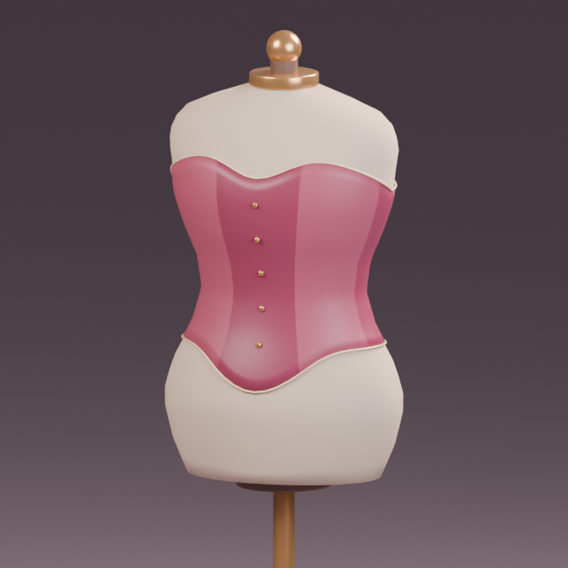

# Avatar clothing workshop

Make a garment on an existing avatar, keep its UVs and rig, and export it for Unity. The workspace runs Blender 4.5 LTS on Windows and on the GitHub runner.



## Open the workshop

On Windows, drag an avatar file onto **Open Blender.cmd**. Double-clicking the launcher opens the sample if you have built it. The launcher uses Python 3.9 or newer and downloads an official portable copy of Blender the first time. It checks Blender’s SHA-256 checksum and resumes interrupted downloads. You can also open a model from the command line.

```powershell
py tools/blender.py open "C:/Art/My Avatar/Body.fbx"
```

A Blender scene, FBX or glTF body works. Press **N** in the 3D View and open **Avatar Clothing**. Use **File → Save As** to save an editable outfit scene. To use the panel in an existing Blender installation, use **Preferences → Add-ons → Install from Disk** and choose `addon/avatar_clothing.py`. You can also set `BLENDER_BIN` to the path of your Blender executable. On Linux use `python3` in place of `py`.

## Make a garment

1. Select the body, enter **Edit Mode**, switch to **Face Select**, and mark the area the garment covers. In the panel, set a fabric clearance and edge depth in millimeters. Choose **Make Garment from Selected Faces**.
2. Sculpt the cut, folds and silhouette on the new mesh. Its turned edges give the fabric visible thickness at the openings. It starts with its own UV layout, the body's bone weights and matching relative shape keys. Adjust the UV seams in Blender’s UV Editor for your fabric pattern.
3. For a skirt, jacket or other piece modeled independently, select it in **Object Mode**, choose its rigged **Body** in the panel, and use **Transfer Body Weights**. The tool blends up to four nearby bone influences per vertex. Work in the rest pose and inspect tight gaps between limbs. Loose skirts and accessories can need hand-painted weights or extra bones.
4. Select the finished garment meshes and use **Export Outfit FBX + UV Guides**. The FBX includes the pieces and their shared skeleton. Each garment mesh gets an SVG guide for painting its active UV map. In Unity, attach the outfit to the matching avatar bones and connect any body-shape sliders to the garment’s matching blendshapes. Test sitting, crouching and raising the arms.

Copied relative shape keys follow the body in the Blender fitting scene. For an independently modeled piece, enable **Match Body Shapes** before transferring weights to fit it to the same sliders. For an outfit with shape keys, finish any modeling modifiers on an editable copy before export. Blender procedural materials can be baked into texture maps for the final Unity materials.

## Work with a full avatar

Use [the avatars folder](avatars/) for each model, its references and its editable outfits. Install [Git LFS](https://git-lfs.com/) and run `git lfs install` before transferring whole avatar models. Reference pictures may also stay in any local folder.

## Run and verify

```powershell
py tools/blender.py demo
py tools/blender.py open "build/demo/Dress form.blend"
py tools/blender.py inspect "build/demo/Dress form.blend" --report "build/body.json"
py tools/blender.py export "build/demo/Dress form.blend" --mesh "Sweetheart bodice" --mesh "Hem piping" --output "build/Fitted top.fbx"
```

The sample creates a dress form and fitted sweetheart bodice from scratch. It renders front and back views, then reimports the outfit FBX and checks its skeleton, deformation under a pose, blendshape, UV coordinates and vertex weights. The editable scene, FBX, UV guides and preview images are in `build/demo/`.

In [Actions → Blender clothing](https://github.com/WeepingAngeIs/z-bug-testing-failed-files/actions/workflows/blender.yml), choose **Run workflow**. Blank inputs build the sample. For a committed avatar, enter its repository path to get a mesh and rig report. To export an outfit as well, enter its mesh names, for example `["Jacket", "Collar"]`. The resulting files are in the run’s **blender-clothing** artifact.
